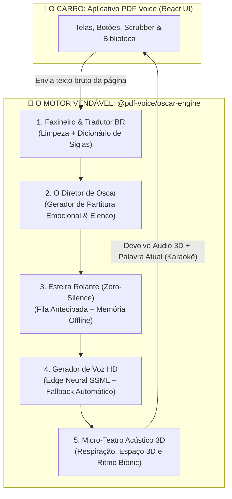

# 🏛️ OscarVoice Engine (v3.0) — Arquitetura de Direção Teatral Autônoma

**Projeto:** PDF Voice (`arthuraef/pdf_tts`)  
**Arquitetura:** SDK Modular Client-Side (Zero-Server Cost)  
**Objetivo:** Transformar documentos estáticos (PDFs) em experiências de áudio dramatizadas com qualidade cinematográfica, áudio espacial 3D e ritmo neuro-adaptativo.

---

## 1. Visão Executiva e Separação de Domínios ("O Carro e o Motor")

Para garantir escalabilidade comercial e valor de propriedade intelectual (M&A / Licenciamento B2B), o projeto é estritamente dividido em duas camadas independentes:

1. **`app-ui` (O Aplicativo / "O Carro"):** Interface em React 19 + Tailwind CSS + Dexie.js. Responsável apenas por exibir botões, biblioteca de livros e barra de progresso.
2. **`oscar-engine` (O Motor / "O Ativo"):** Biblioteca pura em TypeScript, sem dependência de React. Recebe texto bruto e devolve áudio processado em 3D com marcação de palavras em tempo real. Pode ser vendida ou licenciada separadamente.



---

## 2. As 5 Camadas do Motor de Oscar

### Camada 1: `sanitizer` (Higienização e Dicionário PT-BR)
Executa preferencialmente em Web Worker ou pipeline não-bloqueante para não travar a interface:
- **Filtro Geométrico de Cabeçalho/Rodapé:** Ignora blocos de texto nas coordenadas Y superiores a 92% e inferiores a 8% quando apresentarem repetição entre páginas ou padrão de numeração (`Pág. X`, `X/Y`).
- **De-hifenização:** Une palavras quebradas no fim da linha via Regex:  
  `/(?<=[a-zA-ZÀ-ÿ])-[\r\n\s]+(?=[a-zA-ZÀ-ÿ])/g` ➡️ `""`.
- **Dicionário Léxico Brasileiro:** Converte abreviações e algarismos romanos antes do envio ao TTS (`Art. 5º` ➡️ `Artigo quinto`, `Século XXI` ➡️ `Século vinte e um`, `Dr.` ➡️ `Doutor`, `pág.` ➡️ `página`).

### Camada 2: `director` (Partitura Emocional & Bionic Audio)
Analisa cada frase e gera um contrato de atuação (`ActingScoreChunk`):
- **Separação de Elenco (Cast Routing):** Identifica travessões (`—`, `–`) e aspas (`"`, `“`). Alterna automaticamente entre a voz do Narrador (`pt-BR-FranciscaNeural`) e a voz de Personagem (`pt-BR-AntonioNeural`), com panning espacial diferenciado.
- **Modulação Emocional SSML:**
  - *Exclamações / Urgência:* `pitch="+6%"`, `rate="+12%"`, `injectBreathBefore: true`.
  - *Sussurros / Reticências (...):* `pitch="-4%"`, `rate="-10%"`, `pauseAfterMs: 650`.
  - *Títulos e Capítulos:* `pitch="-6%"`, `rate="-8%"`, `pauseAfterMs: 1200`.
- **Bionic Audio (Ritmo Neuro-Adaptativo):** Calcula a densidade léxica da frase (tamanho médio das palavras e presença de números/termos técnicos). Frases simples aceleram (`1.15x` a `1.30x`); frases densas desaceleram (`0.92x` a `1.00x`).

### Camada 3: `transport` (Esteira "Zero Silêncio" e Cache Offline)
- **Janela Deslizante (Lookahead = 3):** Enquanto o chunk $N$ está tocando, os chunks $N+1$, $N+2$ e $N+3$ já estão baixados e decodificados em memória.
- **Persistência em IndexedDB (LRU Cache):** Cada áudio gerado é salvo no disco local indexado por um hash único (`SHA-256(voiceId + ssmlPayload)`). Mantém os últimos 50 capítulos em disco e limpa os mais antigos automaticamente.
- **Paraquedas de 2.000ms (Circuit Breaker):** Toda chamada de rede possui `AbortController` de 2 segundos. Em caso de falha ou lentidão, o motor aciona instantaneamente a Web Speech API nativa para a frase atual e tenta reconectar na próxima.

### Camada 4: `audio-stage` (Micro-Teatro Acústico 3D)
Processamento via Web Audio API nativa (custo zero de CPU/Servidor):
- **Áudio Espacial (Stereo Panning):** Narrador centralizado (`pan: 0`), Personagem A levemente à esquerda (`pan: -0.25`), Personagem B levemente à direita (`pan: +0.25`).
- **Injeção de Respiração Humana:** Samples reais de inspiração (~10KB, volume a 15%) inseridos 250ms antes de frases longas ou dramáticas para eliminar o vale da estranheza robótica.
- **Keep-Alive iOS/Android:** Loop de áudio silencioso contínuo que impede o congelamento da aba quando a tela do celular está bloqueada.

---

## 3. As 5 Leis de Blindagem (Produção Industrial)

| # | Lei de Blindagem | Risco Evitado | Implementação Obrigatória |
|---|---|---|---|
| 🛡️ 1 | **Prevenção de Memory Leak** | App fecha sozinho após 1h | Máximo de 5 `AudioBuffer` em RAM (1 anterior, 1 atual, 3 futuros). Chunks antigos sofrem `disconnect()` e anulação. |
| 🛡️ 2 | **Plano Paraquedas (2.000ms)** | Bolinha de loading infinita | Timeout de 2s com `AbortSignal.timeout(2000)`. Fallback instantâneo para Web Speech API local. |
| 🛡️ 3 | **Sobrevivência com Tela Apagada** | iOS Safari congela a aba | Elemento `<audio loop>` tocando ruído silencioso contínuo em background. |
| 🛡️ 4 | **Proibido Bloquear a UI** | Congelamento no upload do PDF | Lazy Processing: processar apenas a página atual e a próxima. Time-to-First-Audio < 400ms. |
| 🛡️ 5 | **LRU Cache para Disco** | Encher os GBs do celular | Manter no IndexedDB apenas os últimos 50 capítulos. Descarte automático do mais antigo. |

---

## 4. Estrutura de Diretórios Oficial

```
src/
├── oscar-engine/                  # 💎 ATIVO DE PROPRIEDADE INTELECTUAL (TypeScript puro)
│   ├── index.ts                   # Fachada pública (OscarEngine Class)
│   ├── types.ts                   # Interfaces e Contratos de dados
│   ├── sanitizer/
│   │   ├── headerFooterFilter.ts  # Filtro de cabeçalho/rodapé por coordenadas
│   │   ├── dehyphenator.ts        # Junta palavras quebradas por traço
│   │   └── ptBrLexicon.ts         # Tradutor de siglas, leis e romanos
│   ├── director/
│   │   ├── emotionalParser.ts     # Analisador de falas, pontuação e SSML
│   │   ├── bionicSpeed.ts         # Cálculo de velocidade por densidade léxica
│   │   ├── castMemory.ts          # Gráfico de personagens persistente
│   │   └── ssmlBuilder.ts         # Montador do payload SSML para Edge TTS
│   ├── transport/
│   │   ├── edgeNeuralClient.ts    # Comunicação com Edge Neural TTS
│   │   ├── fallbackNativeTts.ts   # Fallback para Web Speech API local
│   │   └── prefetchQueue.ts       # Esteira rolante (Lookahead=3) + IndexedDB
│   └── audio-stage/
│       ├── webAudioStage.ts       # Mesa de som Web Audio API + Stereo Panning
│       ├── breathInjector.ts      # Injeção de micro-respirações humanas
│       └── mp3Exporter.ts         # Exportação de capítulos em MP3
│
└── app-ui/                        # 📱 O SEU APLICATIVO (React 19 + Tailwind)
    ├── components/                # Player, Biblioteca, Scrubber, Modais
    ├── hooks/
    │   └── useOscarEngine.ts      # Hook que conecta a UI ao Motor com 1 linha
    └── db/                        # Persistência Dexie.js de PDFs e progresso
```
